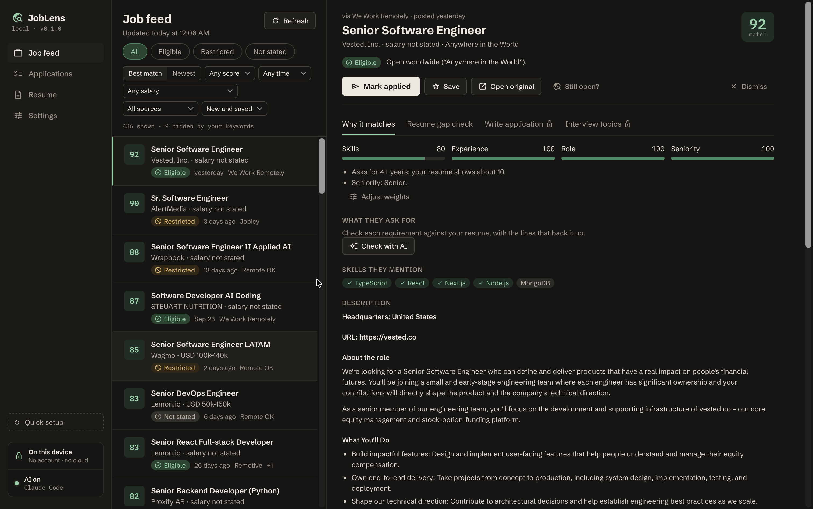
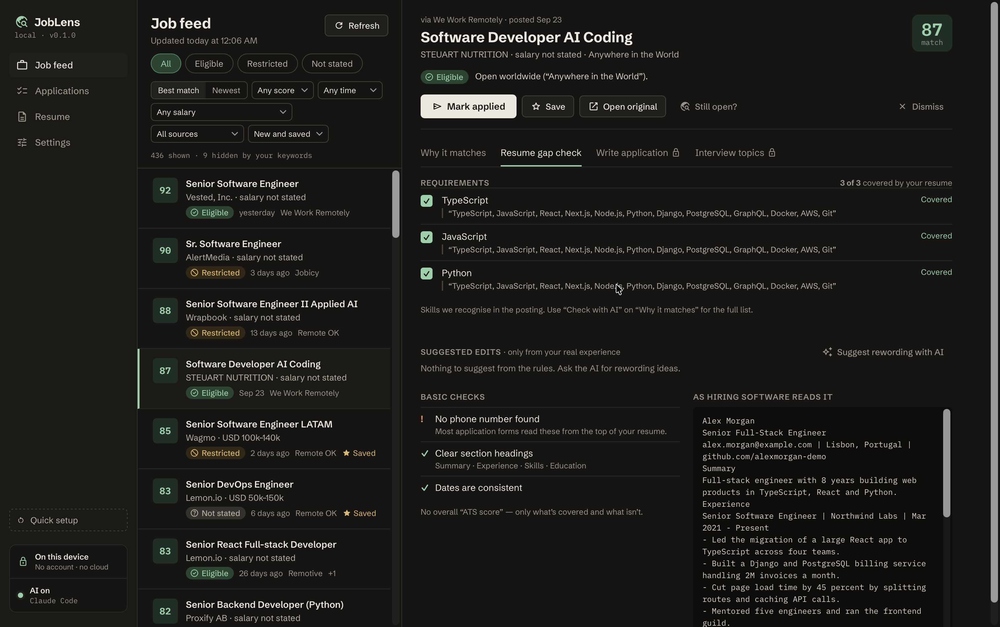
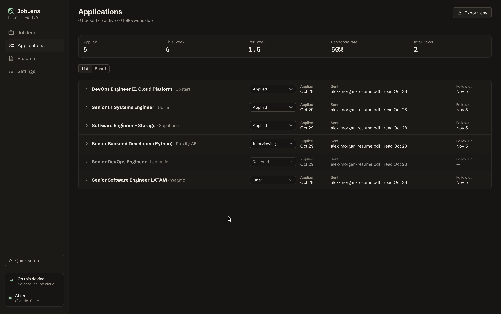
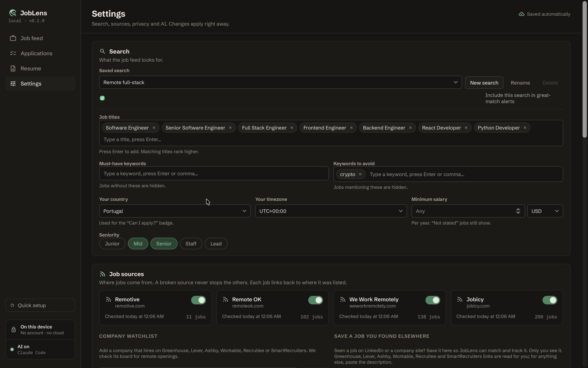
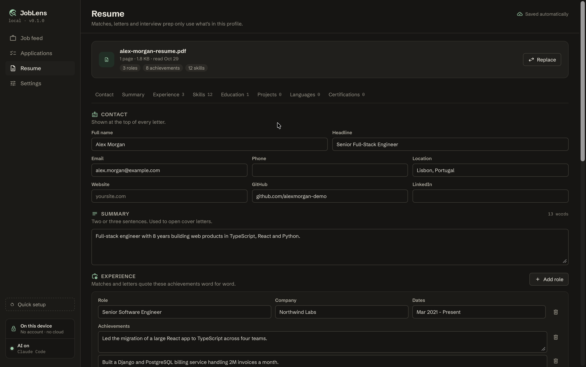

<div align="center">

# JobLens

**Find remote jobs you can actually apply to. Rank them against your real resume. Write honest applications.**

A private desktop app. No account, no cloud, no tracking. Everything stays on your computer.

[Download](https://github.com/faithdevss/joblens/releases) · [Features](#features) · [Build from source](#build-from-source) · [Contributing](#contributing)



</div>

## Why

Most "remote" jobs aren't remote for you: they're US only, or need a time zone you're not in. Job boards don't tell you that until you've read the whole post. AI writing tools make it worse by putting claims in your cover letter that you never made.

JobLens works one loop: **find jobs → drop the ones you can't apply to → rank by fit → prepare the application → track it.** You always submit applications yourself.

## Features

### Job feed with a "Can I apply?" check

One list from several remote job boards plus the companies you follow. Each job shows salary, match score, source and date, and an **Eligible / Restricted / Not stated** badge based on your country and time zone. Missing info shows as "not stated", never guessed. The same job posted on several sites appears once.

**Sources:** Remotive, Remote OK, We Work Remotely, Jobicy, and company career pages on Greenhouse, Lever, Ashby, Workable, Recruitee and SmartRecruiters. You can also paste a job link or description. One broken source never stops the others.

### Why this job matches

The match score breaks down into skills, experience, role and seniority. Each matched requirement links to the resume line that backs it up. Gaps are split into **missing** and **maybe worded differently**. You choose how much each factor counts.

### Resume gap check

For any job, see a checklist of its requirements and whether your resume covers each one. Preview the plain text hiring software reads from your resume, and run basic checks (contact details, section headings, consistent dates). Suggested edits use only your real experience: accept, edit or reject each one. No fake "ATS score".



### Application writer with an honesty check

Write a cover letter or a short email for a job. Every sentence about you is checked against your resume. Anything your resume doesn't back up is highlighted, and you have to fix or confirm it before you can export. Details the app doesn't know stay as blanks, like `[hiring manager name]`. Copy the text, or save it as Word or PDF.

### Application tracker

Track each application as Saved, Applied, Interviewing, Offer, Rejected or Closed. Each one keeps what you sent, the link, notes and a follow-up date. Follow-ups due today show at the top. Export to CSV.



### Quick setup

Drop in a PDF or Word resume. JobLens reads it offline into a profile (roles, dates, skills, achievements) that you check once. Then set your search: titles, must-have and avoid keywords, country, time zone, minimum salary, seniority. You can keep several saved searches and get alerts for new matches.





## Privacy

- Your resume, jobs, letters and history are stored in a local SQLite file.
- No account, no telemetry. The UI's Content Security Policy blocks every network call. Only the Rust backend talks to the network, and only to fetch job listings.
- **AI is optional and off by default.** JobLens works as a filtered job finder without it. If you turn it on, it uses the [Claude Code](https://claude.com/claude-code) CLI already installed on your machine, after asking for your consent.
- Back up everything to one file, restore it on another computer, or delete all your data with one button.

Where the data lives:

| OS | Path |
|---|---|
| macOS | `~/Library/Application Support/app.joblens.desktop/` |
| Linux | `~/.local/share/app.joblens.desktop/` |

## Install

Download the latest build from [Releases](https://github.com/faithdevss/joblens/releases):

- **macOS** (Apple Silicon and Intel): `.dmg`
- **Linux**: `.AppImage` or `.deb`
- **Windows** (experimental): `-setup.exe`

Builds may not be code-signed yet. On macOS, right-click the app and choose **Open** the first time. On Windows, click **More info → Run anyway**.

## Build from source

JobLens is built with [Tauri v2](https://tauri.app) (Rust) and React + TypeScript + Vite, with SQLite bundled through `rusqlite`.

**You need:**

- Node 24+ and pnpm 10
- Rust stable (`rustup`)
- macOS: Xcode command line tools
- Linux: `libwebkit2gtk-4.1-dev libappindicator3-dev librsvg2-dev patchelf libxdo-dev libssl-dev build-essential`

```sh
git clone https://github.com/faithdevss/joblens.git
cd joblens
pnpm install
pnpm tauri dev      # run with hot reload
pnpm tauri build    # release build and installers
```

| Command | What it does |
|---|---|
| `pnpm check` | Everything CI runs: lint, typecheck, JS and Rust tests, clippy |
| `pnpm lint:fix` | Auto-fix formatting and lint (Biome) |
| `pnpm test` | JS tests (Vitest) |
| `pnpm test:rust` | Rust tests; also regenerates `src/bindings/*.ts` |

### Project layout

```
src/                  React UI
  bindings/           TS types generated from Rust (ts-rs). Don't edit; run `pnpm test:rust`
  components/         Shared UI
  views/              One file per top-level screen
  lib/ipc.ts          Typed wrappers for every Tauri command
src-tauri/
  src/commands.rs     Tauri commands exposed to the UI
  src/jobs/           Job sources, refresh, dedupe, feed ranking
  src/resume/         Offline PDF/DOCX resume reader
  src/apply/          Gap check and application writer
  src/ai/             Optional AI through a local CLI
  src/db/             SQLite open and migrations
assets/screenshots/   Images used in this README
```

### Database changes

The schema version lives in SQLite `user_version`. To change the schema, add `src-tauri/src/db/migrations/NNNN_name.sql` and register it in `MIGRATIONS`. Never edit a migration that has shipped.

## Contributing

Issues and pull requests are welcome. Before you open a PR:

1. Run `pnpm check` and make sure it passes.
2. Keep the privacy rules: no telemetry, no network calls from the UI, fonts and icons bundled (no CDN).
3. Never let the app claim something the user's resume doesn't back up.

## Known limits

- PDF export uses a built-in font that covers Western European characters only.
- Two-column resumes may need manual fixes after import.
- AI features support Claude Code only; Codex isn't supported yet.

## License

[MIT](LICENSE)
